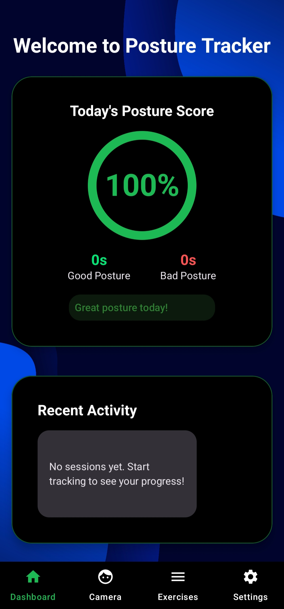
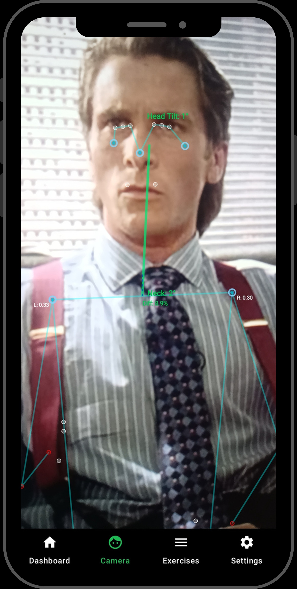
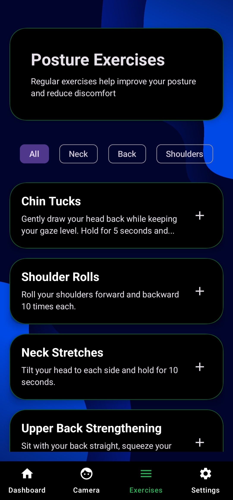
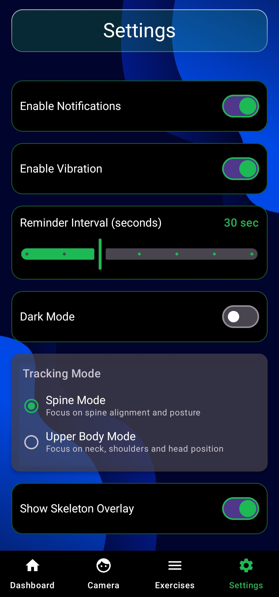

# 🧘 PostureTracker — On-Device Real-Time AI Posture & Ergonomics Monitor

[-3DDC84?style=for-the-badge&logo=android&logoColor=white)](https://developer.android.com/)
[](https://kotlinlang.org/)
[](https://developer.android.com/jetpack/compose)
[](https://developers.google.com/mediapipe)
[](https://developer.android.com/training/camerax)

An intelligent, on-device Android application engineered in **Kotlin** and **Jetpack Compose** that transforms your smartphone camera into an automated posture coach. Powered by **Google MediaPipe Tasks Vision**, PostureTracker evaluates spinal ergonomics in real time, delivers tiered haptic and visual slouch alerts, tracks consistency streaks, and guides users through targeted physical therapy exercises—100% on-device with zero cloud dependencies.

> 📄 **Project Presentation**: Full presentation slides available in [`PostureTracker.pptx`](PostureTracker.pptx).

---

## 📱 App Interface & Visual Showcase

| 📊 Health Dashboard | 📷 Live AI Pose Tracking | 🏋️ Corrective Exercises | ⚙️ Sensitivity & Settings |
|:---:|:---:|:---:|:---:|
|  |  |  |  |
| *Ergonomic score, streaks, and posture trends* | *Real-time skeletal overlay and angle feedback* | *Interactive routines with countdown timer* | *Adaptive sensitivity and notification thresholds* |

---

## 🩺 The Problem & Clinical Motivation

- **Global Ergonomic Crisis**: According to the American Chiropractic Association (ACA), over **80% of individuals experience posture-related musculoskeletal back and neck pain**.
- **Prolonged Screen Time**: Modern desk workers, programmers, and streamers spend an average of **10–12 hours daily** seated in front of digital displays, frequently lapsing into chronic forward-head posture ("Text Neck").
- **Limitations of Current Solutions**: Traditional posture wearables (e.g., Upright GO) cost upwards of $100–$150, require daily charging, and are easily forgotten. Static reminder timers are habitually dismissed without providing corrective feedback.
- **Clinically Backed Intervention**: Studies published by the NIH confirm that **continuous real-time postural feedback improves user ergonomic awareness by 4x**. In trial cohorts, **72% of participants reported reduced neck and back stiffness** within two weeks of regular monitoring.

---

## 🔬 Core Capabilities & Engineering Deep-Dive

### 1. ⚡ On-Device Computer Vision Pipeline
- **100% On-Device Privacy**: No images, video buffers, or telemetry are ever uploaded or transmitted off the device.
- **MediaPipe Pose Landmarker**: Uses the high-precision **Heavy model** (95%+ landmark precision) with a `0.50F` confidence score threshold to reliably map **33 normalized 3D anatomical landmarks** (ear tragus, shoulder acromion, hips, and spine).
- **GPU Hardware Acceleration**: Configured with `DELEGATE_GPU` (OpenGLES/Vulkan), reducing energy consumption to **~12% battery per hour** (versus ~20% when running inference on CPU).
- **Jetpack CameraX**: Zero-copy `ImageAnalysis.Analyzer` lifecycle-aware camera streaming compatible across 1,000+ Android device profiles.

### 2. 📐 Biomechanical Ergonomic Analysis Engine
The custom `PostureAnalyzer` engine performs real-time trigonometric vector mathematics across skeletal coordinates:
- **Craniovertebral & Neck Tilt Angle**: Computes the angle between the shoulder midpoint and ear midpoint using $\text{atan2}(\Delta x, \Delta y)$ against calibrated ergonomic thresholds.
- **Forward Head Posture ("Text Neck")**: Measures the horizontal distance deviation $|\text{earMid}_X - \text{shoulderMid}_X|$ to detect forward cranial displacement.
- **Shoulder Elevation Asymmetry**: Tracks vertical delta $|\text{leftShoulder}_Y - \text{rightShoulder}_Y|$ to flag unlevel slouching or spinal lateral tilt.
- **Spine Curvature Estimation**: Analyzes horizontal alignment between mid-shoulder and mid-hip landmarks $|\text{shoulderMid}_X - \text{hipMid}_X|$.
- **Dynamic Sensitivity Scaling**: Adapts detection thresholds proportionally using a user-calibrated factor:
  $$\text{Threshold Multiplier} = 1.5 - \left(\frac{\text{Sensitivity}}{100.0}\right)$$

### 3. 🎯 Dual Tracking Modes
- **Upper Body Mode**: Optimized for desk workers, laptop users, and remote meetings. Focuses primarily on head-forward tilt, cervical spine angle, and shoulder alignment.
- **Full Spine Mode**: Designed for standing desks, rehabilitation routines, and physical therapy, tracking the full cranial-to-hip alignment chain.

### 4. 🔔 Multi-Modal Tiered Alert System
- **Visual Feedback HUD**: Real-time traffic-light transitions (**Green** $\rightarrow$ **Yellow** $\rightarrow$ **Red**) indicating current posture quality.
- **Custom Haptic Patterns**: Configurable vibration alerts (e.g., 3 rapid pulses for persistent slouching).
- **Sustained Slouch Delay**: Configurable grace period (1–30 seconds) ensuring alerts fire only for sustained poor posture, eliminating false alarms from momentary sips of coffee or reaching for stationery.
- **Meeting Mode**: One-tap toggle to suppress notifications during conference calls.

### 5. 🧘 Corrective Ergonomic Workflows
Includes guided, physiotherapist-aligned exercise routines:
- **Chin Tucks**: Strengthens deep cervical flexors to reverse forward head posture.
- **Shoulder Blade Squeezes**: Activates rhomboids and middle trapezius muscles.
- **Chest Openers & Neck Stretches**: Relieves pectoral tension from rounded shoulders.
- **Interactive UI**: Animated countdown timers, repetition counters, and completion tracking.

---

## 🏗️ System Architecture

```text
[ CameraX Video Stream (ImageAnalysis) ]
                   │
                   ▼ (Zero-Copy ImageProxy)
[ PoseLandmarkerHelper ] ──(GPU Acceleration)──► [ 33-Point 3D Skeletal Landmarks ]
                                                              │
                                                              ▼
                                                   [ PostureAnalyzer ]
                                                    ├── Neck Tilt Angle (atan2)
                                                    ├── Forward Head Displacement
                                                    └── Shoulder Elevation Asymmetry
                                                              │
                                                              ▼ (PostureResult)
                                                   [ CameraViewModel ]
                                                              │
                                                              ▼ (Kotlin StateFlow)
                                               [ Jetpack Compose UI (M3) ]
                                                ├── CameraScreen (Live HUD Overlay)
                                                ├── DashboardScreen (Stats & Streaks)
                                                ├── ExercisesScreen (Timer & Reps)
                                                └── SettingsScreen (Calibration)
```

---

## 🛠️ Technology Stack

| Layer | Technologies |
|---|---|
| **Language** | Kotlin 2.0+ (100% Coroutines & StateFlow) |
| **User Interface** | Jetpack Compose, Material Design 3 (Material You), Navigation Compose |
| **Machine Learning** | Google MediaPipe Tasks Vision (`tasks.vision`), GPU/CPU Delegates |
| **Camera Feed** | Jetpack CameraX (Core, Camera2, Lifecycle, View) |
| **Local Persistence** | Jetpack Room Database (SQLite ORM), Jetpack DataStore Preferences |
| **Architecture** | MVVM (Model-View-ViewModel), Unidirectional Data Flow (UDF) |
| **Target Platforms** | Android 7.0+ (API 24 to API 35) |

---

## 📂 Project Structure

```text
PostureTracker/
├── app/
│   ├── src/main/
│   │   ├── java/com/mobile/posturetracker/
│   │   │   ├── data/
│   │   │   │   ├── AppDatabase.kt          # Room SQLite Database instance
│   │   │   │   ├── PostureSession.kt       # Entity for tracking sessions & metrics
│   │   │   │   ├── PostureSessionDao.kt    # DAO for streak & history queries
│   │   │   │   ├── PostureRepository.kt    # Repository for session persistence
│   │   │   │   └── SettingsRepository.kt   # DataStore preferences repository
│   │   │   ├── ui/
│   │   │   │   ├── screens/
│   │   │   │   │   ├── DashboardScreen.kt  # Scores, goals, streaks & trend charts
│   │   │   │   │   ├── CameraScreen.kt     # Live AI camera with HUD overlay
│   │   │   │   │   ├── ExercisesScreen.kt  # Corrective workouts & countdown timers
│   │   │   │   │   ├── SettingsScreen.kt   # Sensitivity sliders & alert options
│   │   │   │   │   └── GlassCard.kt        # Custom glassmorphic Compose component
│   │   │   │   └── theme/
│   │   │   │       └── PostureTrackerTheme.kt
│   │   │   ├── viewmodel/
│   │   │   │   ├── CameraViewModel.kt      # Camera & ML inference state
│   │   │   │   ├── PostureViewModel.kt     # Dashboard analytics & session state
│   │   │   │   └── SettingsViewModel.kt    # User configuration state
│   │   │   ├── AppNavigation.kt            # Compose Navigation routes
│   │   │   ├── MainActivity.kt             # Single Activity host
│   │   │   ├── PostureAnalyzer.kt          # Biomechanical calculation engine
│   │   │   └── PoseLandmarkerHelper.kt     # MediaPipe Vision wrapper & delegates
│   │   ├── res/                            # Vector drawables, themes, strings
│   │   └── AndroidManifest.xml
│   └── build.gradle                        # App dependencies & NDK packaging
├── screenshots/
│   ├── Dashboard.jpg
│   ├── PostureTracking.jpg
│   ├── Excercises.jpg
│   └── Settings.jpg
├── PostureTracker.pptx                     # Official Project Presentation Deck
├── .gitignore
├── build.gradle                            # Root build config
└── settings.gradle
```

---

## 🚀 Building & Running Locally

### Prerequisites
- **Android Studio** (Hedgehog / Iguana / Ladybug or newer)
- **JDK 17** or **JDK 21**
- **Android SDK** (API 35 installed via SDK Manager)
- Physical Android device with a camera (recommended for GPU-accelerated inference) or an emulator with webcam passthrough.

### Build Commands

```bash
# Clone the repository
git clone https://github.com/Mohamed-Rslan/PostureTracker.git
cd PostureTracker

# Build the debug APK using the Gradle wrapper
# Windows:
gradlew.bat assembleDebug
# macOS/Linux:
# ./gradlew assembleDebug

# Install directly onto a connected device:
gradlew.bat installDebug
```

---

## 🔒 Permissions & Privacy

The application adheres strictly to the principle of least privilege:
- `android.permission.CAMERA`: Exclusively for real-time local camera frames during active tracking sessions. Frames are discarded immediately after inference and never persisted.
- `android.permission.VIBRATE`: For tactile haptic alerts when poor posture is detected.

No account creation, network access, or third-party analytics are required or implemented.

---

## 👥 Development Team (Team 4)

- **Mohamed Amin Werdany Raslan** ([@Mohamed-Rslan](https://github.com/Mohamed-Rslan))
- **Adham Mohamed Helmy Sadek**
- **Ahmed Walid Mohamed Awadallah**
- **Ahmed Nabil Ahmed Emara**
- **Mohamed Adel Moawad Azzam**
- **Mohamed Tamer Hamed Alawy**
